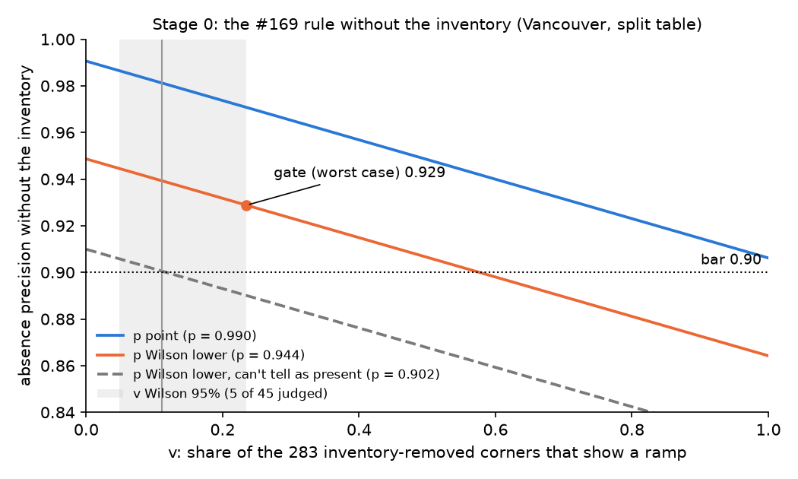

# Corner pre-rater, Stage 0: does the #169 rule need the inventory? (issue #185)

Tool: `scripts/corner_prerater.py` (`gate`, `figures`; `gate --check`). Tests:
`tests/test_corner_prerater.py`. Output: `runs/vancouver/corner_prerater185/gate.json`.
Figure: `docs/figures/corner-prerater-185/stage0_pfree.png`. Plan:
`corner-prerater-absence-2026-11-15.md` (Claude Fable 5.2, reviewed by Claude Opus 5.5), Stage 0
only. Issues: [#185](https://github.com/ProjectSidewalk/sidewalk-auto-labeler/issues/185),
[#169](https://github.com/ProjectSidewalk/sidewalk-auto-labeler/issues/169).

**Result (2026-11-15): PASS.** If the city inventory were not there to remove corners, the
#169 NoCurbRamp rule would still clear its 0.90 bar in Vancouver: worst case **0.929**, point
estimate **0.981**. Under the plan, the stand-in question is closed for Vancouver. A VLM
standing in for the inventory would add about one point of precision. Stages 1 and 2 (Gemini
calls, up to $40) are not approved and were not run.

## The question and the gate

The #169 rule proposes a NoCurbRamp label at each corner the detector calls absent, unless the
city inventory holds a point there (the `discount` read) or no sidewalk reaches it. On the split
table, the rule makes 3,070 proposals, and the inventory removes 283 corners. In a city without
an inventory those 283 would be proposed too. So the question is what precision the rule would
have with them added back:

    P_free = (3,070 * p + 283 * (1 - v)) / 3,353

- **p** is the rated absence precision of the proposals: gallery 169 (split table), blind
  reads, 96 absent of 97 decided = 0.990, Wilson 95% [0.944, 0.998].
- **v** is the share of inventory-removed corners that show a ramp: gallery 243, the
  fusion-absent corners holding an `Available` point, blind reads, 5 present of 45 decided
  (1 can't tell) = 0.111, Wilson 95% [0.048, 0.235].

**Gate (fixed by the plan before this run):** the worst case, with p at its Wilson lower bound
and v at its Wilson upper bound, must be at least 0.90.

| reading | p | v | P_free | clears 0.90 |
|---|---:|---:|---:|:---:|
| **gate: worst case** | 0.9439 | 0.2350 | **0.9288** | yes |
| point estimates | 0.9897 | 0.1111 | 0.9812 | yes |

The script recomputes every input and refuses to run if one does not round to the plan's
value. The 283 is recounted from `corners_full.jsonl` and must equal both `counts.csv` and the
`reason=inventory` rows of `unlabeled.csv`. The 3,070 is recounted through the sidewalk layer.



*P_free as a function of v. Blue uses p's point estimate, orange its Wilson lower bound, and
grey dashed the lower bound with the 3 can't-tell corners counted as present. The shaded band is
v's Wilson interval and the dot is the gate. Data: `figures/corner-prerater-185/data/stage0_pfree.csv`.*

## How robust the pass is

| reading (not gates; reported for Jon) | P_free | clears 0.90 |
|---|---:|:---:|
| p point estimate, every removed corner a ramp (v = 1) | 0.9062 | yes |
| break-even v at p's lower bound | v = 0.576 | - |
| break-even v at p's point estimate | above 1 (holds at any v) | - |
| the 22 removed corners with no `Available` point at v = 1, the other 261 at v's upper bound | 0.9238 | yes |
| over-merge filter applied (below) | 0.9296 | yes |
| only the 250 removed corners the sidewalk rule would keep | 0.9304 | yes |
| **can't tell counted against the rule in both galleries** (p = 96/100, lower bound 0.902; v = 6/46, upper bound 0.257) | **0.8883** | **no** |

The last row is the one reading that falls under the bar, and it stacks three pessimistic
choices: every can't-tell corner taken as a miss in both galleries, and both interval ends at
once. At the point estimates of that reading (p = 0.960, v = 0.130), P_free is 0.952. The #169
pass itself survived the same can't-tell reading (Wilson lower bound 0.902 against its 0.85
clause). This reading does not change the gate. It does mean the margin is about three
points, not ten.

**Two of the readings change N, not v.** Of the 283, 22 are removed by a class other than
`Available` (RMV, a typed `NA`, expired or other), so v, measured only on `Available` corners,
is extrapolated to them; the table puts them at v = 1. The inventory check runs before the
sidewalk check, so 33 of the 283 have no sidewalk within 10 m and would be dropped anyway. That
makes the plan's 283 conservative.

## The over-merge filter

The plan asks for v with and without the filter: "an `Available` point nearer to a present
neighbour's fused site is reassigned to it". Amendment A1 of `docs/corner-inventory.md` is why:
merged legs move sector bounds, so the detector can find a ramp in one sector while the city's
point for it falls in the next. As implemented, an `Available` point leaves an absent corner
when it lies strictly nearer to a fused site of a present **adjacent** corner (the sectors either
side) than to its own corner point. The corner leaves the removed set when all of its `Available`
points leave and no other excluding class holds it.

- **Judged corners (v): no change.** None of the 35 gallery-243 units behind the 46 corners holds
  a present corner. They are the census of wholly fusion-absent target units, so the filter
  cannot reassign anything there. v is 5/45 with and without it.
- **Split-table pool:** 200 of the 261 removed corners with an `Available` point have a present
  adjacent corner, 16 have at least one point that moves, and **15 leave**. Their keys are in
  `gate.json` (`over_merge_filter.split_pool.leave_keys`). If they are counted at p instead
  of 1 - v, the worst case moves from 0.9288 to 0.9296.

This bears on review finding F2. The judged corners come from wholly absent units, while 200
of the 261 in the split pool sit beside a present corner. The filter moves only 15 of those, so
it does not explain the gap. v remains measured on a population unlike most of the pool, and
that is the main caveat on this result. Because the gate takes v at its upper bound, and the
break-even v is 0.576, the pool would need five times the measured rate to fail.

## Amendments

1. **Which gallery-243 verdicts.** `corner-labels-169`, the branch this one is cut from, carries
   the partial export of 50 units (sha256 `0d36ebb4…`). The plan's figure of 5 of 45 is the
   complete export of 95 units (`30a5008d…`, branch `corner-gallery-243-verdicts`, scored in PR
   [#180](https://github.com/ProjectSidewalk/sidewalk-auto-labeler/pull/180)). As the plan's
   Files section says, the script reads that export by path from the gallery 243 worktree, with
   a sha256 pin.
2. **The filter's undefined terms.** The plan does not define "neighbour", "nearer than what" or
   what happens to a corner with several points. I took adjacent sectors, the corner's own
   corner point, and "all `Available` points and no other excluding class". Any reading gives
   the same v here, because the judged units hold no present corner at all.
3. **Inventory positions.** `corners_full.jsonl` stores each inventory point's record but not its
   position, and `UNITID` is not unique in the city file. The script finds each point by its id
   and full record among the features within the unit window, and refuses unless the match is
   unique. All 261 pool corners, and all 46 judged ones, matched uniquely.
4. **Population of the 283.** The formula applies v to all 283, as written. The 22 corners
   without an `Available` point and the 33 without a sidewalk are reported as sensitivity
   readings, not folded into the gate.

## Replication

Run from the repo root of this worktree, which sits beside `corner169`, `posdetect241` and
`gallery243` under `D:\Git\labeler-wt\` and below `D:\Git\sal-vancouver`. The sidewalk reading
needs shapely ≥ 2, so use the conda env:

```bash
P=/c/Users/jonf/anaconda3/envs/sidewalk-auto-labeler/python.exe
$P scripts/corner_prerater.py gate            # writes runs/vancouver/corner_prerater185/gate.json
$P scripts/corner_prerater.py gate --check    # CHECK OK: ... reproduces (PASS, worst case 0.9288)
$P scripts/corner_prerater.py figures         # docs/figures/corner-prerater-185/
$P -m pytest tests/test_corner_prerater.py --doctest-modules scripts/corner_prerater.py
```

The tool commit is `82b47cd` on branch `corner-prerater-185`, recorded as `tool_git_sha` in `gate.json`. `--check` ignores only that field
and `built_at`. Inputs, all sha256-pinned in the script (`PINS`) and recorded in `gate.json`:

| input | path (relative to this worktree) | sha256 |
|---|---|---|
| split corner table | `../corner169/runs/vancouver/corner_inventory169_split/corners_full.jsonl` | `b50da32e…` |
| old corner table | `../posdetect241/runs/vancouver/corner_inventory_posdetect241/corners_full.jsonl` | `ec206060…` |
| fused sites | `../../sal-vancouver/runs/vancouver/sites.jsonl` (+ the two posdetect241 runs) | `9d1fc51a…`, `d38c6fa0…`, `df0dec5c…` |
| city inventory | `../../sal-vancouver/runs/vancouver/inventory_oracle/inventory.geojson` | `c4d24979…` |
| gallery 243 items, verdicts | `../gallery243/runs/vancouver/corner_gallery243/` | `bbed3d6d…`, `30a5008d…` |
| gallery 169 split items, verdicts | `runs/vancouver/corner_gallery169_split/` | `e7648a48…`, `da3f0114…` |
| #169 sample, counts, unlabeled | `runs/vancouver/corner_labels169_split/na_discount_sw/` | `14911083…`, `790e379b…`, `b0a73c10…` |
| sidewalk layer | `../corner169/runs/vancouver/corner_labels169/sidewalks/cov_sidewalks.geojson` | `11503ed4…` |

## Where each number lives

| number | where |
|---|---|
| 3,070 proposals, 283 removed (261 with `Available`, 22 without) | `gate.json` `counts`; `na_discount_sw/counts.csv` |
| p = 96/97 = 0.990 [0.944, 0.998] | `gate.json` `p`; `na_discount_sw/score_gallery169.json` |
| v = 5/45 = 0.111 [0.048, 0.235]; 40 / 5 / 1 blind | `gate.json` `v` |
| worst case 0.9288, point 0.9812, PASS | `gate.json` `gate` |
| every sensitivity reading | `gate.json` `readings` |
| break-even v 0.576 / 1.073 | `gate.json` `breakeven_v` |
| can't-tell-against bounds 0.902 / 0.257 | `gate.json` `cant_tell_against` |
| filter: judged 0 of 35 units with a present corner, split 200 / 16 / 15 | `gate.json` `over_merge_filter` |
| 250 of 283 with a sidewalk; 3,070 recounted | `gate.json` `sidewalk` |
| figure curves | `docs/figures/corner-prerater-185/data/stage0_pfree.csv` |

## What happens next (from the plan)

The stand-in half stops here for Vancouver. That decision is Jon's: accept this reading, or ask
for a city where the inventory removes more (plan section 8, decision 1). Stage 1, calibrating a
VLM pre-rater on the 381 judged corners (up to $40, Gemini Argon and Flash), is the next step,
and it needs Jon's approval. Nothing past Stage 0 was run.
