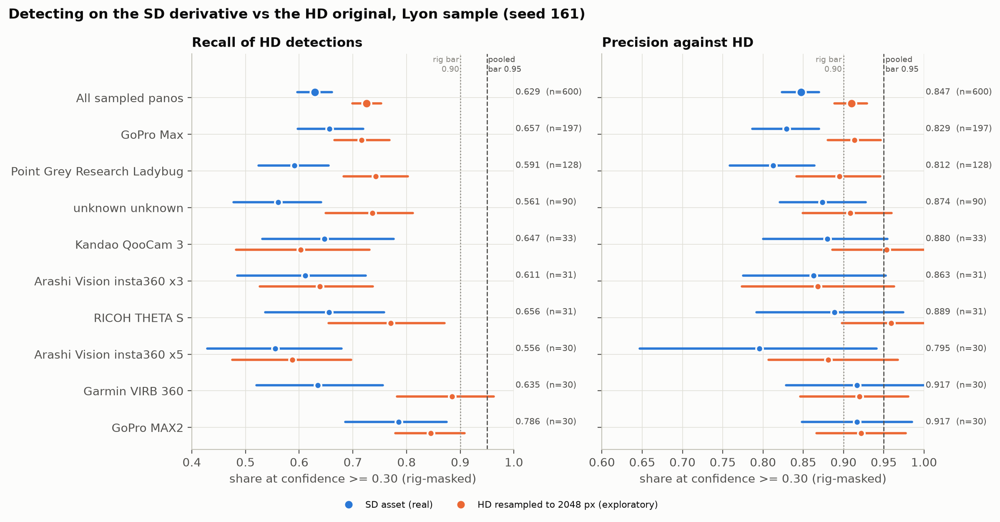
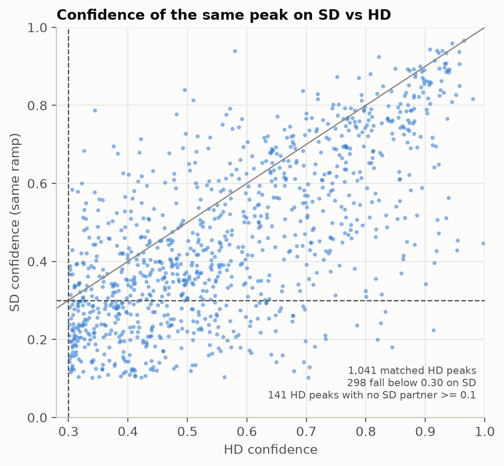

# Panoramax SD vs HD: does the lighter asset cost detections? (issue #161)

Panoramax's maintainers asked two things in #161: whether we really need the
full-resolution `hd` original for the computer-vision step, since the `sd` derivative
(2,048 px wide) is far lighter to serve, and whether we could pace downloads at about one
per second. The pacing is now the source's default, along with batched metadata and a
concurrency cap; see `sources/panoramax.py`. This study answers the first question with
the production detector, on a seeded sample of the Lyon run, under a rule written down
before any arm was scored.

## 1. Pre-registration (committed before the first scoring run)

Everything in this section was committed and pushed before `score` was run on any arm.
Section 2 onwards is filled in afterwards.

**Inputs.** The Lyon 5 m run's `results.jsonl` as archived on the lab file server
(`runs/lyon/results.jsonl` beside the native-res `panos/`; 174,405 records, sha256
`60e688b28b62f85e71f51c603dc1b6f4ff020348220c6cc7955891dcfef061ef`, verified when the
sample was drawn). Rigs (`camera_make camera_model`) and HD dimensions come from that file;
the HD pixels are the archive's JPEGs; the SD pixels are the live `sd` assets, fetched once
at 1 picture/s through the source's own limiter.

**Sample** (`sample`, seed 161). 500 detection-bearing panos (at least one stored
detection >= 0.30 after the camera-rig mask) and 100 empty ones, stratified by rig within
each stratum: every rig with at least 30 detection-bearing panos gets 30, the remaining
seats are proportional to the rig's pool (largest remainder); the empty stratum is
proportional. Within a rig, ids are sorted, shuffled with `random.Random(161)` (one
generator, strata in order), and the first k taken. The drawn sample is
`runs/_summary/panoramax_asset/sample.csv`.

**Arms.** Every arm's image is decoded to RGB and resized to 4,096 x 2,048 BILINEAR, which
is what `sources/panoramax._download_image` feeds the detector, then run through
`CurbRampDetector(batch_size=1)` with the default decode (argmax) and border rule
(exclude) -- the settings the Lyon run used (its records carry neither key).

- `hd`: the archived original.
- `sd`: the real `sd` asset.
- `sd_sim` (exploratory, outside the rule): the archived original resized to 2,048 px wide
  with LANCZOS and back up, which separates resampling from SD's JPEG re-encode.

**Sanity gate.** The `hd` arm on the archived bytes must reproduce the run's stored
detections, or the pipeline under test is not production's. Pass iff (a) at least 99% of
sampled panos have the identical set of rig-masked peaks >= 0.30 (exact normalized x, y),
ignoring any peak within 0.005 of 0.30 in either list, and (b) the largest |confidence
difference| over peaks at the same position, at least one of them >= 0.30, is <= 0.01. If
the gate fails the study stops, the default stays `hd`, and that is reported.

**Matcher.** RampNet's pano-frame geometry, as in `scripts/agree_rate.py`: x scaled by
1,024 and y by 512, x cyclic at the seam, greedy ascending-distance one-to-one, strictly
within 0.022 normalized-x units (~22.5 heatmap px, ~3 coarse cells). Detections are
rig-masked (`detectors.on_camera_rig`) throughout, as production ships them.

**Metrics** for `sd` and `sd_sim` against `hd`, at 0.30 (operational) and 0.55
(benchmark), pooled over the sample as drawn and per rig:

- strict recall-of-HD: HD peaks >= t matched one-to-one by arm peaks >= t, over HD peaks >= t;
- lenient recall-of-HD: HD peaks >= t matched by arm peaks >= the 0.1 storage floor;
- precision-vs-HD: matched over arm peaks >= t (strict matching);
- matched confidence delta (arm - HD): median, and the 90th percentile of |delta|;
- where matched pairs sit on the stride-8 heatmap grid: the share at <= 1 px Chebyshev
  offset (same coarse cell), at 7-9 px (one cell over), and other;
- the frame facts: how often the item's `sensor_array_dimensions` equal the archived HD
  file's dimensions, and how often the SD asset is 2,048 wide and 2:1.

95% intervals are percentile intervals of a pano-level (cluster) bootstrap, 2,000
resamples, seed 161: peaks on one pano are not independent, so panos are resampled.

**Default rule.** `sd` becomes the default for `--panoramax-asset` iff, for the `sd` arm at
0.30,

1. pooled strict recall-of-HD >= 0.95 AND pooled precision-vs-HD >= 0.95 (point
   estimates; the lower 95% bounds are reported beside them), AND
2. no rig with >= 30 sampled panos has a 95% UPPER bound below 0.90 on either.

Otherwise the default stays `hd` and the write-up says what SD would cost. `sd_sim`, the
0.55 tier, the lenient recall and the offset shares are reported and never read by the
rule. There is no Lyon ground truth in `../RampNet/benchmark/` (checked 2026-10-28), so
this study measures agreement with HD, not correctness; an SD-vs-GT arm is not possible yet.

**What the rule does not settle.** Agreement with HD is the question the maintainers asked
("is HD needed?"), not whether SD finds more or fewer *real* ramps. And the PS crops, the
PS pano store and the native-res archive all read HD whichever asset detection uses.

## 2. Results (scored 2026-10-28, after the pre-registration above was pushed)

> **Key takeaways**
>
> 1. **SD does not meet the bar, so the default stays `hd`.** On the real SD asset at the
>    operational tier 0.30, pooled strict recall-of-HD is **0.629** (95% 0.597-0.661) and
>    precision-vs-HD **0.847** (0.823-0.870), against a 0.95 bar on each; every rig with
>    >= 30 panos fails on recall (upper bounds 0.641-0.875). Figure
>    `agreement_by_rig.png`; `summary.csv` / `per_rig.csv`, columns `recall*`, `precision*`.
> 2. **Most of the loss is confidence, not blindness.** SD scores the same peak lower
>    (median delta -0.066, 90th percentile |delta| 0.28): of the 1,182 HD peaks >= 0.30,
>    1,041 still have an SD peak >= 0.1 nearby (lenient recall **0.881**), and 298 of those
>    fall below 0.30. Only 141 have nothing on SD at all. Figure `confidence_sd_vs_hd.png`;
>    `summary.csv` `recall_lenient`, `dconf_median`, `abs_dconf_p90`.
> 3. **SD also moves peaks.** 35% of matched pairs sit one coarse heatmap cell (7-9 px at
>    1024 x 512) from their HD partner, against 24% for HD resampled through 2,048 px;
>    `summary.csv` `adjacent_cell_share`.
> 4. **Resolution alone costs most of it; SD's JPEG re-encode adds the rest.** HD shrunk to
>    2,048 px and back (`sd_sim`, exploratory) keeps 0.726 strict recall and 0.910
>    precision: the detector, trained on full-resolution panoramas, needs the pixels.
> 5. **The SD frame question is settled for later use:** on all 600 panos the item's
>    `sensor_array_dimensions` equal the archived HD file's dimensions, and every SD asset
>    is exactly 2,048 x 1,024. SD is 18.1x lighter on the wire (166 MB vs 3,015 MB for these
>    600 pictures). `verdict.json` `frame`; `sd_fetch.csv` `bytes`.

**Sanity gate: PASS.** The `hd` arm on the archived bytes reproduced the stored run on 600 of
600 panos (identical rig-masked peak sets >= 0.30), with a largest confidence difference of
6.5e-5 (bar 0.01) on an RTX 3070 against the original run's GPU. `gate.csv`.

**Pooled, sd arm** (rig-masked; 600 panos; 95% pano-bootstrap intervals):

| tier | HD peaks | SD peaks | matched | strict recall | precision | lenient recall | median dconf | same cell / one cell over / other |
|---|---|---|---|---|---|---|---|---|
| 0.30 | 1,182 | 878 | 744 | 0.629 (0.597-0.661) | 0.847 (0.823-0.870) | 0.881 (0.860-0.900) | -0.066 | 0.62 / 0.35 / 0.03 |
| 0.55 | 538 | 347 | 292 | 0.543 (0.497-0.586) | 0.841 (0.802-0.877) | 0.941 (0.920-0.959) | -0.046 | 0.68 / 0.30 / 0.01 |

`sd_sim` (exploratory) at 0.30: strict recall 0.726 (0.699-0.753), precision 0.910
(0.889-0.929), lenient recall 0.950; at 0.55: 0.636 / 0.875 / 0.987.

**Per rig, sd arm at 0.30** (the rule's second clause; every row has >= 30 panos):

| rig | panos | HD peaks | strict recall (upper 95%) | lenient recall | precision (upper 95%) |
|---|---|---|---|---|---|
| GoPro Max | 197 | 370 | 0.657 (0.719) | 0.903 | 0.829 (0.870) |
| Point Grey Research Ladybug | 128 | 264 | 0.591 (0.655) | 0.848 | 0.813 (0.864) |
| unknown (no make/model) | 90 | 148 | 0.561 (0.641) | 0.858 | 0.874 (0.928) |
| Kandao QooCam 3 | 33 | 68 | 0.647 (0.776) | 0.853 | 0.880 (0.955) |
| Arashi Vision insta360 x3 | 31 | 72 | 0.611 (0.724) | 0.889 | 0.863 (0.952) |
| RICOH THETA S | 31 | 61 | 0.656 (0.758) | 0.951 | 0.889 (0.974) |
| Arashi Vision insta360 x5 | 30 | 63 | 0.556 (0.679) | 0.810 | 0.795 (0.941) |
| Garmin VIRB 360 | 30 | 52 | 0.635 (0.756) | 0.923 | 0.917 (1.000) |
| GoPro MAX2 | 30 | 84 | 0.786 (0.875) | 0.917 | 0.917 (0.985) |

**Rule outcome: `hd`** (`verdict.json`): both pooled clauses fail, and all nine rigs fail
clause 2 on recall (GoPro Max and the Ladybug on precision too). `--panoramax-asset` keeps
`hd` as its default; `sd` stays available, bound per run.

**What SD would cost.** Run on SD at 0.30, a Lyon-like city would miss about 37% of the
labels HD ships (744 of HD's 1,182 peaks matched), and it would ship 26% fewer labels in all
(878 against 1,182), about 15% of which are labels HD does not make (878 - 744 = 134);
lowering the threshold to win recall back trades it against precision on an image the model
was not trained on. What it would save: 18x the bytes per picture on Panoramax's side.
Recovering SD would need a model trained or fine-tuned at that resolution, which is a
RampNet question, not a labeler one.

**What the politeness changes buy instead.** At HD, pacing is the lever: 1 picture/s (about
1.7 s/picture end to end in this study's SD fetch: 600 pictures, 0 errors, 0 pauses;
`fetch_meta.json`), one
`/search` request per 100 pictures (6 metadata requests for the 600), and 4 workers instead
of 50.



*Q: at 0.30, does SD find what HD finds, and only that? Dots are point estimates, whiskers
95% pano-bootstrap intervals, dashed lines the pre-registered bars. Blue = the real SD asset
(the rule's arm); orange = HD resampled to 2,048 px (exploratory).*



*Q: when SD and HD agree on a ramp, does SD score it lower? Each dot is an HD peak >= 0.30
and its one-to-one SD partner (any SD peak >= 0.1); the diagonal is equal confidence.*

`figures/panoramax-asset/contact_sheet_disagreements.png` shows 6 HD-only and 6 SD-only
peaks drawn with seed 161, each as an HD crop beside the SD crop of the same window,
captioned with its producer and licence (Etalab-2.0 for Grand Lyon / IGN pictures, CC BY-SA
4.0 otherwise), via Panoramax. Each window is +-6 degrees around the peak, wrapped across
the seam and padded grey past the top or bottom, so the cross is always on the peak.

## 3. Replication

| input | sha256 | where |
|---|---|---|
| Lyon 5 m `results.jsonl` (174,405 records) | `60e688b28b62f85e71f51c603dc1b6f4ff020348220c6cc7955891dcfef061ef` | lab file server, `.../sidewalk-auto-labeler/runs/lyon/` |
| the 600 HD JPEGs | per file in the archive's `index.csv` (600/600 verified after transfer) | same dir, `panos/<id>.jpg` |
| the 600 SD JPEGs (fetched 2026-10-28) | per file in `sd_fetch.csv` | live `sd` assets; may change |
| `sample.csv` | `1e84b8eac71f49c8bb6c454df779cdc1e8be9d12892aedf2c44b53e115355119` | committed |
| `stored.jsonl` (the 600 sampled records) | `6c8984e63b5a32041f8e150461117bb56357efaf4e4bbb485f8b0e05172e4ace` | written by `sample` into `<data>` |
| `detections.jsonl` (all three arms) | `5adf596d98f8d0eba6f7eb103abcc79322220931ca26d7a9460ba54f8e9001b2` | committed |

Commands, in order (`<data>` is a local scratch dir; pixels never leave it):

```bash
python scripts/panoramax_asset_study.py sample --results <lyon results.jsonl> --data <data>
# copy the files <data>/ids.txt names from the archive's panos/ into <data>/hd/ (one tar
# stream), and check each against the archive's index.csv
python scripts/panoramax_asset_study.py search-check --n 20      # live, 21 requests
python scripts/panoramax_asset_study.py fetch-sd --data <data>    # live, 600 SD at 1/s
python scripts/panoramax_asset_study.py run --data <data>         # GPU; resumable, --arms
python scripts/panoramax_asset_study.py score --data <data>
python scripts/panoramax_asset_study.py figures                   # committed files only
python scripts/panoramax_asset_study.py contact-sheet --data <data>
```

Seed 161 (sample, bootstrap, contact sheet). Model `rampnet-model@606a11956743`, revision
`606a11956743f7eb328d9207769034752f6191f4`, argmax decode, `exclude` border, batch size 1.
Python 3.12.13, torch 2.8.0+cu126, transformers 5.12.1, Pillow 12.3.0, matplotlib 3.11.2.
Host: Windows 11 desktop, NVIDIA RTX 3070 (8 GB; peak 4,288 MiB allocated). Runtime: SD fetch
1,037 s for the whole command (600 pictures, ~1.7 s each; `fetch_meta.json`); `run` 1,711 s for hd + sd_sim (1,200 forwards) and 615 s
for sd (600), ~0.95 s per forward plus decode; `score` and `figures` take seconds.
`figures` is byte-reproducible from the committed `summary.csv`, `per_rig.csv` and
`detections.jsonl` (checked by running it twice). `score` reads `<data>`'s
`detections.jsonl` and `stored.jsonl`; the committed `detections.jsonl` holds the same
detections and native sizes (content-identical) but drops the local copy's `forward_s`
timing column, so the two files are not byte-identical.

## 4. Where each number lives

All under `runs/_summary/panoramax_asset/` unless noted.

| number | file | column / key |
|---|---|---|
| pooled strict recall, precision, CIs | `summary.csv` | `recall`, `recall_lo/hi`, `precision`, `precision_lo/hi` |
| lenient recall | `summary.csv`, `per_rig.csv` | `recall_lenient*` |
| confidence delta | `summary.csv`, `per_rig.csv` | `dconf_median`, `abs_dconf_p90` |
| grid offsets | `summary.csv`, `per_rig.csv` | `same_cell_share`, `adjacent_cell_share`, `other_offset_share` |
| per-rig rows and the rule's upper bounds | `per_rig.csv` | `rig`, `panos`, `recall_hi`, `precision_hi` |
| per-pano counts | `per_pano.csv` | `hd_n`, `arm_n`, `matched`, `matched_lenient` |
| sanity gate | `gate.csv`, `verdict.json` | `identical_030`, `max_dconf`; `gate_*` |
| frame facts | `verdict.json` | `frame` |
| rule outcome and reasons | `verdict.json` | `default`, `reasons` |
| SD bytes, sizes, fetch status | `sd_fetch.csv` | `bytes`, `sd_width`, `sd_height`, `status` |
| /search vs /pictures equivalence | `search_check.csv` | `identical_block` |
| sample strata and pools | `sample.csv`, `sample_meta.json` | `rig`, `stratum`; `pools`, `drawn` |
| GPU, timings, peak memory | `run_meta_pass1.json` (hd, sd_sim), `run_meta_pass2.json` (sd) | |
| SD fetch pacing and request counts | `fetch_meta.json` | `s_per_picture`, `panoramax_requests` |
| 1,041 / 298 / 141 (figure 2's annotation) | recomputed from `detections.jsonl` by `figures` | |
